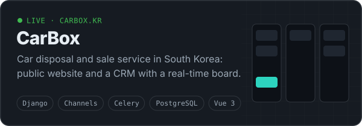
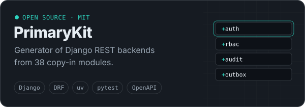
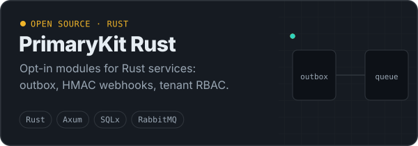
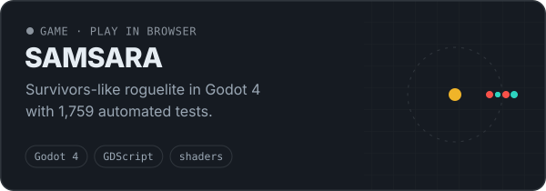

<p align="center">
  
</p>

```python
class ArturKim:
    role       = "Backend Developer @ Oitech"      # since Sep 2025
    location   = "Almaty, Kazakhstan"               # open to remote work and relocation
    stack      = ["Python", "Django", "DRF", "PostgreSQL", "Celery", "Docker"]
    domains    = ["payments", "fiscal receipts", "loyalty", "CRM", "integrations"]
    shipped    = {"merged_prs": 814, "repos": 14}   # at Oitech so far
    previously = "accountant and cashier, 6 years"  # zero cash discrepancies

    def workflow(self):
        return "small PR -> tests -> CI -> review -> prod"  # built with Claude Code and Codex
```

### Projects

<p>
  <a href="https://carbox.kr"></a>
  <a href="https://github.com/RoshihOPM/primarykit"></a>
  <a href="https://github.com/RoshihOPM/primarykit-rust"></a>
  <a href="https://roshihopm.itch.io/samsara"></a>
</p>

### Stack


### Contact

[LinkedIn](https://www.linkedin.com/in/artur-kim-opm/) · Telegram [@ArturOPM1103](https://t.me/ArturOPM1103) · kim1103@mail.ru

<sub>Fonts in the banner and cards: Inter Tight and JetBrains Mono (SIL Open Font License), embedded as subsets. Stack icons: skillicons.dev.</sub>
